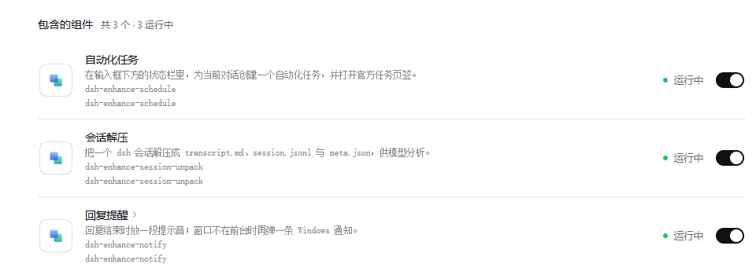
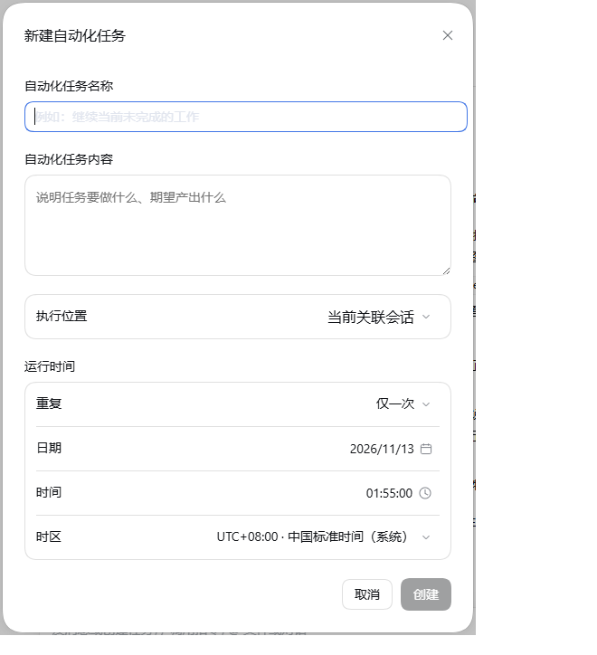
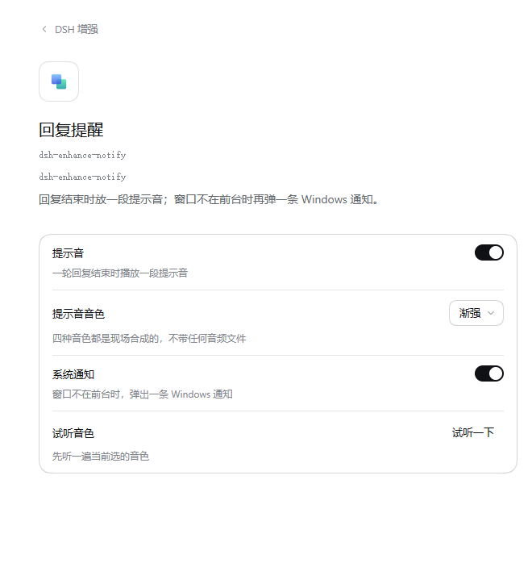
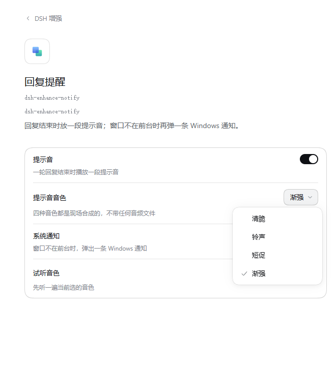

# dsh-enhance

Three additions to **DeepSeek Harness (dsh)**. It is **one plugin, three independently switchable
components**:

| Component | What it does | Documentation |
| --- | --- | --- |
| **Automation task** (`dsh-enhance-schedule`) | Create an automation task *for the conversation you are in*, from the composer dock, and open the shipped right-Sidebar task page on it. | [Component README](./packages/schedule/README.en.md) |
| **Session unpack** (`dsh-enhance-session-unpack`) | A model-facing `unpack_session` tool that unpacks one dsh Session into a readable directory (`transcript.md` + `session.jsonl` + `meta.json`). | [Component README](./packages/session-unpack/README.en.md) |
| **Reply alerts** (`dsh-enhance-notify`) | A chime when a reply finishes, plus a Windows notification while the window is in the background. | [Component README](./packages/notify/README.en.md) |

Each component carries its own name, description and switch on the Plugins page — turning one off
leaves the others working.

> What each component does, how to use it, the decisions behind it and its tests live in **that
> component's own README**. This document covers the bundle itself: how it mounts the three
> components in dsh, how to install and uninstall it, and how to build it.

[中文](./README.md) | English

---

## Screenshots

<p align="center">
  
</p>

The Plugins page: three components, each with its own name, description and switch — turning one off
leaves the other two working.

<table>
  <tr>
    <td align="center" width="33%">
      
      <br><b>Automation task</b>
      <br>The creation dialog
    </td>
    <td align="center" width="33%">
      
      <br><b>Reply alerts</b>
      <br>The settings on the plugin's detail page
    </td>
    <td align="center" width="33%">
      
      <br><b>Tone picker</b>
      <br>Four tones, and picking one plays it
    </td>
  </tr>
</table>

All four tones (*Chime*, *Bell*, *Pulse*, *Wave*) are synthesized with Web Audio on the spot — no
audio file ships; the switches and the tone live in this browser's `localStorage`.

---

## Layout

The bundle carries no code of its own: it inserts three rows into the composition tree. The code lives
in the three component packages, each with a README of its own.

```
dsh-enhance/                  bundle: inserts three rows, carries no code
├── cordis.patch.yml
├── locale/                   plugin-page title and description
├── icon.svg
└── packages/
    ├── schedule/             component one: automation task
    │   ├── README.md         what it does, how to use it, its decisions, its tests
    │   ├── src/index.js      Host half (empty entry)
    │   ├── src/client/       browser half (split into a dozen modules)
    │   ├── lib/              build output (not tracked)
    │   └── tsdown.config.mjs
    ├── session-unpack/       component two: session unpack
    │   ├── README.md
    │   ├── src/index.js      Host entry: registers the tool, asks for approval
    │   ├── src/session-unpack/  the reader itself (frames / zip / paths / log / transcript / artifacts)
    │   ├── lib/              build output (not tracked)
    │   └── tsdown.config.mjs
    └── notify/               component three: reply alerts
        ├── README.md
        ├── src/index.js      Host half (empty entry)
        ├── src/client/       browser half (status events / chime / notification / configuration page)
        │   └── components/settings-page.js  the settings page on the Plugins page
        ├── lib/              build output (not tracked)
        └── tsdown.config.mjs
```

## Install

The bundle carries no code of its own: it inserts three rows into the composition tree, one per component,
and all three component packages have to reach the profile's `node_modules` under their own names.

### 1) Build first

A link installation points at this directory, so the build has to exist before the plugin is installed:
without `lib/`, the Host finds an empty entry when it loads a component by package name.

```sh
# build all three components from the root
npm install
npm run bundle
```

Or build one component at a time (`npm run watch` keeps rebuilding while you edit `src/`):

```sh
cd packages/schedule && npm install && npm run bundle
cd packages/session-unpack && npm install && npm run bundle
cd packages/notify && npm install && npm run bundle
```

> The build needs one development dependency, `tsdown`. The runtime has none: the artifacts contain only
> Node's own modules.

### 2) Install into the profile

```sh
# 1) the bundle itself (it defines the list of included components)
dsh plugin --profile <your profile> add link:/absolute/path/dsh-enhance

# 2) the three component packages (plain dependencies, not profile layers)
dsh plugin --profile <your profile> add link:/absolute/path/dsh-enhance/packages/schedule
dsh plugin --profile <your profile> add link:/absolute/path/dsh-enhance/packages/session-unpack
dsh plugin --profile <your profile> add link:/absolute/path/dsh-enhance/packages/notify
```

The component packages declare no `dsh.bundle` and are installed as plain dependencies; the Host
says so while it loads the profile and reconciles the dependencies, not while `add` runs. That is expected:
a component package must not become a profile layer of its own, or it would show up as a separate plugin.
The bundle's patch rows find them by package name.

With `dsh --profile <your profile> --dump-config` you can see the `dsh-enhance` layer in the tree, and
the Plugins page lists the three components with a switch each.

Requires dsh **>= 0.2.2-rc.1** (declared in `engines.dsh`). The browser half is a Web composition
package; the desktop app (Electron) uses the same browser half.

## Uninstall

`dsh plugin` forwards to pnpm and removes one dependency per call, so run all four:

```sh
dsh plugin --profile <your profile> remove dsh-enhance
dsh plugin --profile <your profile> remove dsh-enhance-schedule
dsh plugin --profile <your profile> remove dsh-enhance-session-unpack
dsh plugin --profile <your profile> remove dsh-enhance-notify
```

With only the first command, the three component packages stay in the profile's `node_modules` as plain
dependencies: nothing in the composition tree refers to them any more, but the files stay on disk.

## How the bundle mounts the three components

| Part | Responsibility |
| --- | --- |
| `cordis.patch.yml` | Inserts three rows into the composition tree, one per component (each id equals its package name) |
| `locale/*.json` | The title and description of this bundle on the Plugins page |
| `locale/*.json` (one per component package) | The name and description of each component on the Plugins page |
| `icon.svg` | The plugin icon |

No component package declares `dsh.bundle`: they are plain dependencies, found by the bundle's patch
rows through their package name. A component package that became a profile layer of its own would
show up on the Plugins page as another standalone plugin — exactly what has to be avoided.

## Decisions at the bundle level

- **No browser half imports a Harness Client package**: the controls of all three components are drawn
  by the plugin, with the Host theme's tokens (`--dsw-*`) and sprite symbols as the only styling
  dependency. That keeps the plugin from fighting the front-end packages of a given dsh version; the
  price is that a re-themed Host may look slightly different from the shipped UI, though it never
  misaligns.
- **No runtime dependencies**: the artifacts of all three components contain Node's own modules only;
  development needs nothing but `tsdown`.
- **dsh's source is never patched**: it is a plain plugin, so upgrading dsh needs no patch.
- **The Host contracts each component depends on** (`conversation.composer.dock`,
  `remote.schedule.create`, `sidebarRight.openTab`, `api-session/status`, `plugins.row.config`,
  `ctx.tools.register`, `ctx.approval`) are listed in that component's own README — when the Host
  changes one, only that component has to follow.

## Develop

> A separate guide describes the **one bundle, several independently switchable components** pattern:
> how to lay it out, how to install it, and the traps it comes with — [`docs/multi-component-bundle.md`](./docs/multi-component-bundle.md)
> (written in Chinese).

```sh
npm run bundle                     # build all three components into lib/

node --check packages/schedule/src/client/index.js
node --check packages/schedule/src/index.js
node --check packages/session-unpack/src/index.js
node --check packages/session-unpack/src/session-unpack/index.js
node --check packages/notify/src/client/index.js

node --test tests/client-behavior.mjs         # the automation-task component
node --test tests/host-session-unpack.mjs      # the session-unpack component
node --test tests/host-tool-registration.mjs   # the session-unpack component: registration and approval
node --test tests/notify-behavior.mjs          # the reply-alerts component
```

None of the four test files needs a browser or a dsh process. What each of them covers is written in
the README of the component it belongs to:

- [Automation task](./packages/schedule/README.en.md#build-and-test)
- [Session unpack](./packages/session-unpack/README.en.md#build-and-test)
- [Reply alerts](./packages/notify/README.en.md#build-and-test)

## License

MIT
