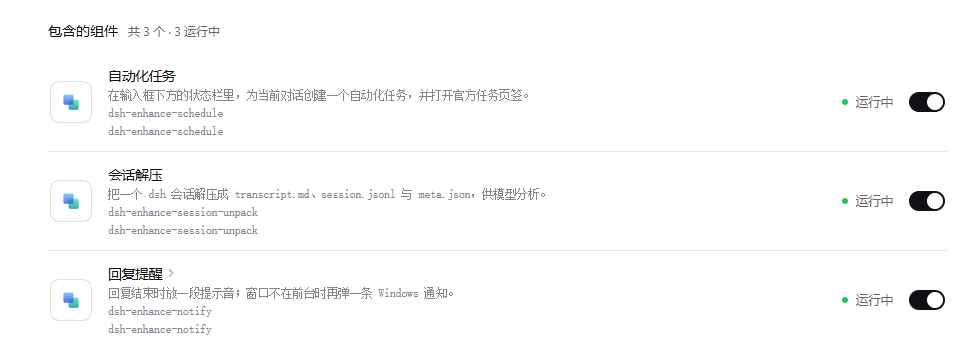
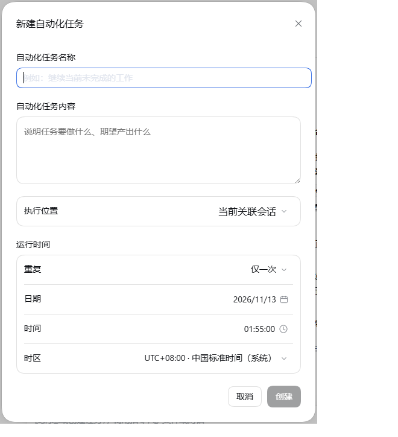
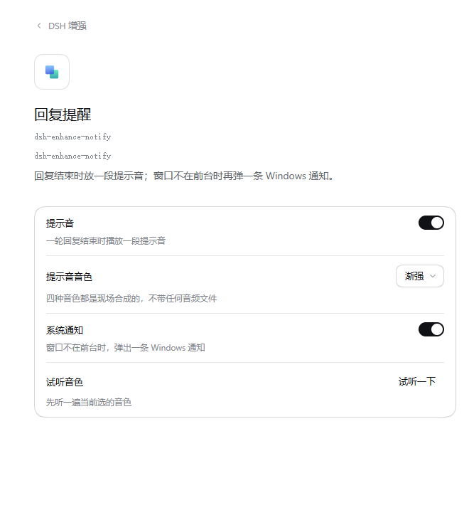
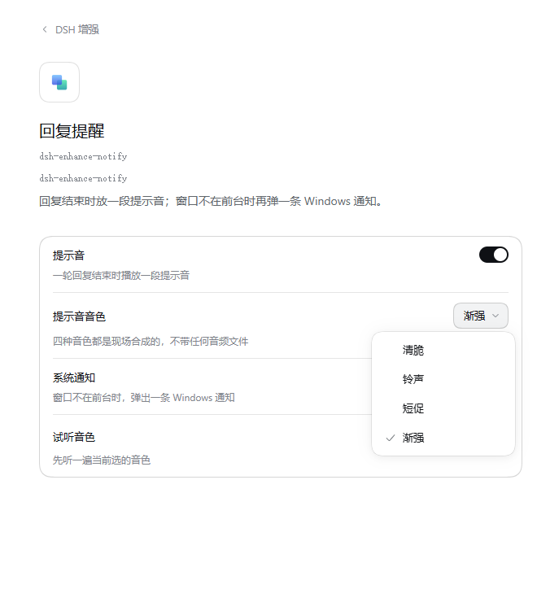

# dsh-enhance

给 **DeepSeek Harness（dsh）** 补三块能力。它是**一个插件、三个可分别启停的组件**：

| 组件 | 做什么 | 文档 |
| --- | --- | --- |
| **自动化任务**（`dsh-enhance-schedule`） | 在输入框下方的状态栏里，为**当前对话**创建一个自动化任务，并直接打开官方右侧任务页签 | [组件 README](./packages/schedule/README.md) |
| **会话解压**（`dsh-enhance-session-unpack`） | 给 agent 一个 `unpack_session` 工具，把一个 dsh session 解压成可读的目录（`transcript.md` + `session.jsonl` + `meta.json`） | [组件 README](./packages/session-unpack/README.md) |
| **回复提醒**（`dsh-enhance-notify`） | 一轮回复结束时放一段提示音；窗口不在前台时再弹一条 Windows 通知 | [组件 README](./packages/notify/README.md) |

插件页里这三个组件各带自己的名字、描述和开关 —— 关掉其中一个，另一个照常工作。

> 每个组件的功能、用法、实现取舍与测试都写在**它自己的 README** 里。这一份只讲 bundle 本身：
> 它怎么把三个组件装进 dsh、怎么装、怎么卸、怎么构建。

中文 | [English](./README.en.md)

---

## 界面

<p align="center">
  
</p>

插件页：三个组件各带自己的名字、描述和开关，关掉其中一个另两个照常工作。

<table>
  <tr>
    <td align="center" width="33%">
      
      <br><b>自动化任务</b>
      <br>新建任务的弹窗
    </td>
    <td align="center" width="33%">
      
      <br><b>回复提醒</b>
      <br>插件详情页里的设置
    </td>
    <td align="center" width="33%">
      
      <br><b>音色下拉</b>
      <br>四种音色，选中即试听
    </td>
  </tr>
</table>

回复提醒的四种音色（清脆 / 铃声 / 短促 / 渐强）全部由 Web Audio 现场合成，不带任何音频文件；
开关与音色记在浏览器的 `localStorage` 里。

---

## 目录结构

bundle 自己不带代码，它只往组合树里插三行。代码在三个组件包里，每个包一份 README。

```
dsh-enhance/                  bundle：只往组合树里插三行，自己不带代码
├── cordis.patch.yml
├── locale/                   插件页的标题与描述
├── icon.svg
└── packages/
    ├── schedule/             组件一：自动化任务
    │   ├── README.md         这个组件的功能、用法、取舍与测试
    │   ├── src/index.js      宿主半（空入口）
    │   ├── src/client/       浏览器半（按职责拆成十几个模块）
    │   ├── lib/              构建产物（不入库）
    │   └── tsdown.config.mjs
    ├── session-unpack/       组件二：会话解压
    │   ├── README.md
    │   ├── src/index.js      宿主入口：注册工具、处理越界批准
    │   ├── src/session-unpack/  解压实现（frames / zip / paths / log / transcript / artifacts）
    │   ├── lib/              构建产物（不入库）
    │   └── tsdown.config.mjs
    └── notify/               组件三：回复提醒
        ├── README.md
        ├── src/index.js      宿主半（空入口）
        ├── src/client/       浏览器半（状态事件订阅 / 提示音 / 系统通知 / 配置页）
        │   └── components/settings-page.js  插件详情页里的设置页
        ├── lib/              构建产物（不入库）
        └── tsdown.config.mjs
```

## 安装

这是一个 dsh **组合包（bundle）**，装进 profile 即可。bundle 自己不带代码，它只往组合树里插三行，
分别指向三个组件包；三个组件包也要一起装进 profile 的 `node_modules`，宿主才能按包名加载它们。

### 1) 先构建

link 安装指向的就是这个目录，所以**装之前必须先构建一次**，否则 profile 里没有 `lib/`，
宿主按包名加载组件时只会拿到一个空入口：

```sh
# 根目录一次构建三个组件包
npm install
npm run bundle
```

也可以进单个组件包构建（`npm run watch` 则是一直盯着 `src/` 重建）：

```sh
cd packages/schedule && npm install && npm run bundle
cd packages/session-unpack && npm install && npm run bundle
cd packages/notify && npm install && npm run bundle
```

> 构建只需要一个开发期依赖：`tsdown`。运行时依赖为零，产物里只有 Node 自带模块。

### 2) 再装进 profile

```sh
# 1) bundle 本身（它定义「包含的组件」这个清单）
dsh plugin --profile <你的 profile> add link:/绝对路径/dsh-enhance

# 2) 三个组件包（普通依赖，不是 profile layer）
dsh plugin --profile <你的 profile> add link:/绝对路径/dsh-enhance/packages/schedule
dsh plugin --profile <你的 profile> add link:/绝对路径/dsh-enhance/packages/session-unpack
dsh plugin --profile <你的 profile> add link:/绝对路径/dsh-enhance/packages/notify
```

> `declares no dsh.bundle — installed as a plain dependency, not a profile layer` 这句
> 是**装载 profile 时**（dsh 启动做依赖对账）打的，不是 `add` 命令当场打的。
> **这是预期的**：组件包不该自己成为 profile layer，否则它们会变成三个独立的插件。
> bundle 的 patch 行按包名找它们，pnpm 把它们 link 进 `node_modules` 就够了。

装完用 `dsh --profile <你的 profile> --dump-config` 可以看到 `dsh-enhance` 这一层已经进树，
插件页的「包含的组件」显示三个组件、各自一个开关。

> 需要 dsh **>= 0.2.2-rc.1**（由包清单里的 `engines.dsh` 声明）。
> 浏览器端是 Web 组合包，桌面端（Electron）同样使用这套浏览器半。

## 卸载

`dsh plugin` 是 pnpm 的转发器，一次只删一个依赖，所以四条都要执行：

```sh
dsh plugin --profile <你的 profile> remove dsh-enhance
dsh plugin --profile <你的 profile> remove dsh-enhance-schedule
dsh plugin --profile <你的 profile> remove dsh-enhance-session-unpack
dsh plugin --profile <你的 profile> remove dsh-enhance-notify
```

只删第一条的话，三个组件包会作为普通依赖留在 profile 的 `node_modules` 里：组合树不再引用它们，
但文件还在盘上。

## bundle 是怎么把三个组件装进去的

| 部位 | 职责 |
| --- | --- |
| `cordis.patch.yml` | 往组合树里插三行，一行一个组件（id 与包名同名） |
| `locale/*.json` | 插件页上这个 bundle 的标题与描述 |
| 组件包里的 `locale/*.json` | 插件页上每个组件的名字与描述 |
| `icon.svg` | 插件图标 |

组件包都**不声明 `dsh.bundle`**：它们是普通依赖，靠 bundle 的 patch 行按包名被找到。
一个组件包如果自己成了 profile layer，它就会在插件页上变成另一个独立插件 —— 那正是要避免的。

## bundle 层面的取舍

- **客户端半不 import 任何 Harness Client 包**：三个组件的控件都是自绘的，只用宿主主题的 token
  （`--dsw-*`）与 sprite symbol。好处是插件不会和某个 dsh 版本的前端包实现打架；
  代价是主题改版时观感可能和官方有细微差别，但不会错位。
- **运行时零依赖**：三个组件的产物里只有 Node 自带模块，没有第三方运行时依赖；
  开发期只需要 `tsdown`。
- **不改动 dsh 源码**：纯插件实现，升级 dsh 不用打补丁。
- **各组件依赖的宿主契约**（`conversation.composer.dock`、`remote.schedule.create`、
  `sidebarRight.openTab`、`api-session/status`、`plugins.row.config`、`ctx.tools.register`、
  `ctx.approval`）写在各自组件的 README 里 —— 宿主改了哪一个，只有那一个组件要跟着改。

## 开发

> 另有一份独立文档讲**「一个 bundle 装多个可分别启停的组件」这套模式**怎么搭、怎么装、踩过哪些坑：
> [`docs/multi-component-bundle.md`](./docs/multi-component-bundle.md)。

```sh
npm run bundle                                       # 构建三个组件到 lib/

node --check packages/schedule/src/client/index.js
node --check packages/schedule/src/index.js
node --check packages/session-unpack/src/index.js
node --check packages/session-unpack/src/session-unpack/index.js
node --check packages/notify/src/client/index.js

node --test tests/client-behavior.mjs         # 自动化任务组件
node --test tests/host-session-unpack.mjs      # 解压组件
node --test tests/host-tool-registration.mjs   # 解压组件：工具注册与批准顺序
node --test tests/notify-behavior.mjs          # 回复提醒组件
```

四个测试文件都不需要浏览器，也不需要 dsh 进程。每个测试文件覆盖什么，写在对应组件的 README 里：

- [自动化任务](./packages/schedule/README.md#构建与测试)
- [会话解压](./packages/session-unpack/README.md#构建与测试)
- [回复提醒](./packages/notify/README.md#构建与测试)

## License

MIT
